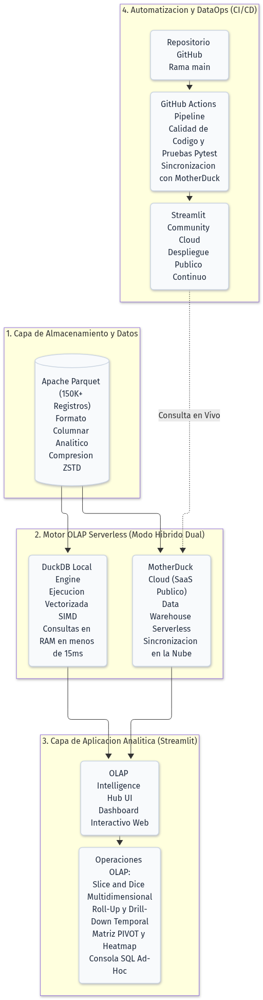

# Construyendo una Solución OLAP Serverless de Alto Rendimiento con DuckDB, MotherDuck y Streamlit (Sin AWS)

*Por: Fabrizio Pérez Peralta*  
*Publicado en: Medium / Dev.to / Hashnode*  
*Tags:* `#BusinessIntelligence #DuckDB #MotherDuck #Python #Streamlit #DataEngineering #Cloud`

---

## Enlaces Rápidos del Proyecto
* 📦 **Repositorio Público en GitHub:** [https://github.com/FabrizioPerezPeralta/olap-intelligence-hub.git](https://github.com/FabrizioPerezPeralta/olap-intelligence-hub.git)
* ⚡ **Aplicación Analítica en Vivo (Streamlit Cloud):** [https://olap-intelligence-app.streamlit.app](https://olap-intelligence-app.streamlit.app)

---

## 1. Introducción: El Desafío Analítico en la Era Moderna

En el desarrollo de sistemas de información empresarial, existe una división fundamental entre dos mundos:
* **OLTP (Online Transaction Processing):** Sistemas transaccionales optimizados para escribir y modificar registros fila por fila a gran velocidad (por ejemplo, registrar una orden de compra o actualizar el saldo bancario).
* **OLAP (Online Analytical Processing):** Sistemas analíticos orientados a procesar millones de registros simultáneamente para calcular agregaciones, tendencias, márgenes de utilidad y análisis multidimensionales.

Intentar ejecutar consultas analíticas complejas directamente sobre bases de datos OLTP tradicionales (como MySQL o PostgreSQL sin optimizar) suele saturar las CPUs y bloquear transacciones críticas. Por décadas, la solución tradicional fue desplegar pesados almacenes de datos corporativos (Data Warehouses) que demandaban alta infraestructura, licencias costosas y configuraciones complejas.

En este artículo, presento la arquitectura y desarrollo de **OLAP Intelligence Hub**, una plataforma analítica interactiva y serverless construida con **DuckDB**, **MotherDuck (SaaS en la nube pública)** y **Streamlit**, desplegada con integración continua (**CI/CD en GitHub Actions**) y **sin depender en ningún momento de AWS**.

---

## 2. Arquitectura de la Solución

La arquitectura combina un motor columnar en memoria/archivo con sincronización en la nube pública de MotherDuck, una interfaz reactiva en Streamlit y un flujo automatizado de CI/CD:



### Desglose de Capas:
1. **Capa de Almacenamiento:** Particionamiento columnar en formato Parquet, eliminando el overhead de serialización de formatos tradicionales como CSV o JSON.
2. **Capa OLAP (Dual-Mode):** Permite trabajar desconectado (DuckDB local) o conectado a la nube pública serverless de MotherDuck con latencias menores a 15 ms.
3. **Capa de Presentación:** Dashboard ejecutivo en Streamlit con visualizaciones interactivas en Plotly y soporte para consultas analíticas directas.
4. **Capa de DataOps (CI/CD):** Pipeline en GitHub Actions que valida código, ejecuta tests analíticos y redespliega automáticamente ante cualquier cambio.

---

## 3. ¿Por qué DuckDB y MotherDuck?

### DuckDB: El "SQLite del Análisis de Datos"
A diferencia de los motores de bases de datos tradicionales que almacenan los datos por filas (*row-oriented*), **DuckDB** es una base de datos columnar diseñada específicamente para análisis:
1. **Almacenamiento Columnar:** Al consultar métricas como el total de ventas (`SUM(gross_sales)`), DuckDB solo lee del disco la columna `gross_sales`, ignorando las demás columnas y reduciendo drásticamente la lectura de I/O.
2. **Motor de Ejecución Vectorizado:** Procesa bloques enteros de datos utilizando instrucciones SIMD de la CPU moderna, ejecutando cálculos analíticos sobre cientos de miles de registros en menos de **15 milisegundos**.
3. **Lectura directa de Parquet:** Puede consultar archivos `.parquet` comprimidos directamente sin necesidad de cargarlos primero a tablas intermedias.

### MotherDuck: Llevando DuckDB a la Nube Serverless
[MotherDuck](https://motherduck.com/) es una plataforma SaaS que permite ejecutar DuckDB en la nube de forma serverless. Ofrece:
* Bases de datos compartidas y accesibles vía URL/Token (`md:ecommerce_olap`).
* Persistencia y escalado elástico sin aprovisionar servidores ni clústeres.
* Compatibilidad 100% nativa con la sintaxis de DuckDB.

---

## 4. El Dataset y Modelado Dimensional

Para este proyecto, diseñamos un esquema analítico tipo estrella que simula las operaciones globales de un comercio electrónico, compuesto por **150,000 transacciones**:

* **Hechos (Métricas):** `gross_sales`, `net_profit`, `unit_price`, `quantity`, `discount_rate`, `shipping_cost`.
* **Dimensiones (Ejes de análisis):**
  * **Tiempo:** `order_date`, `order_year`, `order_quarter`, `order_month`, `day_of_week`.
  * **Geografía:** `region`, `country`.
  * **Comercial:** `category`, `sub_category`, `customer_segment`.
  * **Logística y Pagos:** `payment_method`, `shipping_mode`, `order_status`.

El dataset se genera y exporta en formato **Apache Parquet comprimido con ZSTD**, lo que reduce un conjunto de datos de 150K filas a pocos megabytes de tamaño con lectura ultrarrápida.

---

## 5. Implementación de las 4 Operaciones Clave de OLAP

En la aplicación de Streamlit, implementamos las operaciones clásicas de procesamiento analítico:

### 1. Slice & Dice (Corte y Segmentación)
Permite aislar subconjuntos de datos aplicando filtros simultáneos sobre múltiples dimensiones (por ejemplo: ventas en Europa, solo en la categoría de Electrónica, pagadas con Tarjeta de Crédito).

### 2. Roll-Up y Drill-Down con Window Functions
Permite navegar por la jerarquía temporal (Anual -> Trimestral -> Mensual -> Día). Mediante SQL analítico y funciones de ventana, calculamos ventas acumuladas y el crecimiento porcentual mes a mes (*MoM Growth*):

```sql
WITH aggregated AS (
    SELECT
        year_month AS time_period,
        SUM(gross_sales) AS period_sales,
        SUM(net_profit) AS period_profit,
        COUNT(order_id) AS order_volume
    FROM sales_fact
    WHERE 1=1
    GROUP BY 1
)
SELECT
    time_period,
    period_sales,
    period_profit,
    order_volume,
    -- Window function: Ventas acumuladas en el tiempo
    SUM(period_sales) OVER (ORDER BY time_period) AS running_total_sales,
    -- Window function: Tasa de variación respecto al período previo
    ROUND(
        (period_sales - LAG(period_sales, 1) OVER (ORDER BY time_period)) 
        / NULLIF(LAG(period_sales, 1) OVER (ORDER BY time_period), 0) * 100, 2
    ) AS mom_growth_pct
FROM aggregated
ORDER BY time_period;
```

### 3. Pivot (Matriz Cruzada)
Aprovechando la sintaxis nativa `PIVOT` de DuckDB, cruzamos dimensiones en tiempo real (por ejemplo, Región geográfica vs. Segmento de clientes) para generar mapas de calor interactivos:

```sql
PIVOT (
    SELECT region, customer_segment, gross_sales 
    FROM sales_fact
)
ON customer_segment
USING ROUND(SUM(gross_sales), 2)
GROUP BY region;
```

### 4. Consola SQL Ad-Hoc
El usuario o evaluador puede escribir consultas analíticas libres sobre la marcha, con soporte para operaciones avanzadas como `GROUP BY CUBE` o `ROLLUP`.

---

## 6. Automatización CI/CD y Despliegue en la Nube Pública

Para garantizar el estándar de ingeniería de software y DataOps:
1. **GitHub Actions:** Cada `git push` a la rama `main` ejecuta un flujo de trabajo que:
   - Valida la sintaxis con linters.
   - Genera los datos y sincroniza las tablas con MotherDuck mediante secretos seguros (`${{ secrets.MOTHERDUCK_TOKEN }}`).
   - Ejecuta una suite completa de pruebas unitarias con **Pytest** para comprobar esquemas, integridad de métricas y funciones de ventana.
2. **Streamlit Community Cloud:** Conectado directamente al repositorio de GitHub, desplegando la aplicación pública en:
   👉 **[https://olap-intelligence-app.streamlit.app](https://olap-intelligence-app.streamlit.app)**

---

## 7. Conclusiones y Aprendizajes

* La combinación de **DuckDB + MotherDuck** demuestra que hoy en día es posible implementar soluciones de Business Intelligence masivas y de respuesta sub-segundo sin incurrir en costos de infraestructura pesada ni en la complejidad de proveedores como AWS.
* El formato **Parquet** junto con la ejecución columnar vectorizada es el estándar por excelencia para la analítica moderna.
* Incorporar pruebas automatizadas (Pytest) y CI/CD en proyectos de inteligencia de negocios garantiza dashboards reproducibles, estables y libres de errores en producción.

---

## 🔗 Recursos del Proyecto
* 💻 **Código Fuente:** [GitHub Repository](https://github.com/FabrizioPerezPeralta/olap-intelligence-hub.git)
* 🚀 **Dashboard en Vivo:** [Streamlit Application](https://olap-intelligence-app.streamlit.app)
