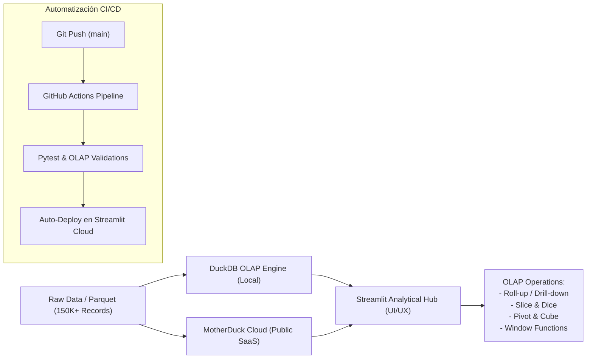

# ⚡ OLAP Intelligence Hub: Serverless Analytics with DuckDB & MotherDuck

[](https://github.com/<TU_USUARIO>/<TU_REPO>/actions)
[](https://share.streamlit.io/)
[](https://duckdb.org/)
[](LICENSE)

Solución analítica de **Procesamiento Analítico en Línea (OLAP)** moderna, serverless y de alto rendimiento, desarrollada con **DuckDB**, **MotherDuck (SaaS en la nube)** y **Streamlit**, con integración y despliegue continuo (**CI/CD**) automatizado a través de **GitHub Actions** y publicación en la nube pública (*sin utilizar AWS*).

---

## 🌟 Arquitectura de la Solución



### Características Principales:
1. **Motor OLAP Columnar y Vectorizado:** Consultas analíticas complejas en milisegundos sobre más de 150,000 transacciones.
2. **Nube Pública / SaaS (Cero AWS):**
   - **MotherDuck:** Base de datos analítica serverless en la nube pública.
   - **Streamlit Community Cloud:** Alojamiento público de la aplicación web.
3. **Operaciones OLAP Implementadas:**
   - **Roll-Up / Drill-Down:** Navegación jerárquica en el tiempo (Mensual, Trimestral, Anual) con funciones de ventana (`SUM(...) OVER`, `LAG(...) OVER`).
   - **Slice & Dice:** Filtros multidimensionales reactivos por geografía, categorías, segmentos de clientes y métodos de pago.
   - **Pivot & Heatmap:** Cruce de dimensiones usando la sintaxis nativa `PIVOT` de DuckDB.
   - **Consola Ad-Hoc:** Permite ejecutar consultas SQL libres con soporte para `GROUP BY CUBE` y `ROLLUP`.
4. **Despliegue y Automatización:**
   - Flujo de integración continua con GitHub Actions que valida datos, sintaxis y tests analíticos.
   - Despliegue automático en la nube pública ante cualquier cambio en la rama principal.

---

## 📂 Estructura del Repositorio

```text
├── .github/
│   └── workflows/
│       └── ci.yml               # Pipeline de CI/CD en GitHub Actions
├── .streamlit/
│   └── config.toml              # Configuración y tema visual de Streamlit
├── data/
│   └── sample_ecommerce.parquet # Dataset analítico optimizado (generado)
├── docs/
│   └── ARTICLE_GUIDE.md         # Guía de redacción de artículos para el equipo
├── scripts/
│   └── generate_sample_data.py  # Generador de datos sintéticos y sincronizador Cloud
├── src/
│   ├── __init__.py
│   └── database.py              # Capa de conexión y consultas analíticas OLAP
├── tests/
│   └── test_olap_queries.py     # Suite de pruebas unitarias para consultas OLAP
├── .env.example                 # Plantilla de variables de entorno
├── .gitignore                   # Exclusiones de Git
├── app.py                       # Aplicación principal de Streamlit
├── requirements.txt             # Dependencias de Python
└── README.md                    # Documentación del proyecto
```

---

## 🚀 Instalación y Ejecución Local

### 1. Clonar el Repositorio
```bash
git clone https://github.com/<TU_USUARIO>/<TU_REPO>.git
cd <TU_REPO>
```

### 2. Crear y Activar Entorno Virtual
```bash
python -m venv venv

# En Windows:
.\venv\Scripts\activate

# En Linux/Mac:
source venv/bin/activate
```

### 3. Instalar Dependencias
```bash
pip install -r requirements.txt
```

### 4. Generar Dataset Analítico Inicial
```bash
python scripts/generate_sample_data.py
```

### 5. Ejecutar la Aplicación
```bash
streamlit run app.py
```
Abre tu navegador en `http://localhost:8501`.

---

## ☁️ Conexión con MotherDuck (Cloud SaaS)

Para ejecutar las consultas en la nube pública de MotherDuck:
1. Crea una cuenta gratuita en [MotherDuck](https://motherduck.com/).
2. Ve a tu perfil y genera un **User Token**.
3. Configúralo localmente en un archivo `.env`:
   ```bash
   MOTHERDUCK_TOKEN=tu_token_aqui
   ```
4. Sube los datos a la nube ejecutando:
   ```bash
   python scripts/generate_sample_data.py
   ```
La aplicación detectará automáticamente el token y pasará a modo **Cloud SaaS**.

---

## 🔄 Despliegue Automatizado en la Nube Pública

1. Sube este repositorio a tu cuenta de **GitHub** en modo público.
2. Ingresa a [share.streamlit.io](https://share.streamlit.io/) e inicia sesión con tu GitHub.
3. Haz clic en **"New app"**, selecciona tu repositorio, rama `main` y archivo principal `app.py`.
4. En **Advanced Settings > Secrets**, pega tu token de MotherDuck si deseas que consuma la nube:
   ```toml
   MOTHERDUCK_TOKEN = "tu_token_aqui"
   ```
5. Haz clic en **"Deploy"**. A partir de ese momento, cada `git push` a `main` activará:
   - El pipeline de **GitHub Actions** (validando tests y calidad).
   - La actualización automática en vivo de la aplicación en **Streamlit Cloud**.

---

## 🧪 Ejecución de Pruebas Unitarias
```bash
pytest tests/ -v
```

---

## ✍️ Artículos Publicados por el Equipo

Los artículos del proyecto fueron redactados y publicados en plataformas especializadas de tecnología:

| Integrante | Tema Central del Artículo | Plataforma | Enlace |
| :--- | :--- | :--- | :--- |
| **Integrante 1** | *Arquitectura OLAP moderna con DuckDB & MotherDuck* | Dev.to / Medium / HashNode | `[Próximamente]` |
| **Integrante 2** | *Modelado Dimensional y Visualización Interactiva en Streamlit* | Dev.to / Medium / HashNode | `[Próximamente]` |
| **Integrante 3** | *Automatización de Pipelines Analíticos con CI/CD en GitHub Actions* | Dev.to / Medium / HashNode | `[Próximamente]` |

*(Consulta la guía detallada de publicación en [docs/ARTICLE_GUIDE.md](docs/ARTICLE_GUIDE.md)).*
